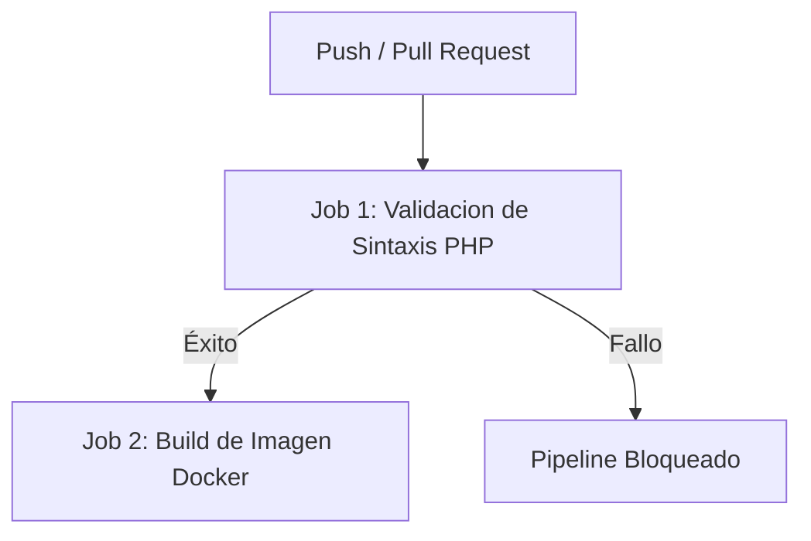

# 🚀 Caso Práctico: Integración Continua (CI/CD) con Nginx, PHP y GitHub Actions

> **Módulo:** Despliegue de Aplicaciones Web (2º DAW)  
> **Tecnologías:** Nginx, PHP 8.2-FPM, Docker, GitHub Actions, Git  
> **Objetivo:** Automatizar la verificación de sintaxis de código PHP y el empaquetamiento en contenedores Docker mediante pipelines de CI/CD.

---

## 📋 1. Descripción del Proyecto

Este proyecto implementa una arquitectura web modular con un servidor **Nginx** actuando como servidor web y proxy inverso hacia un servicio **PHP-FPM (FastCGI)**. Todo el proyecto se encuentra contenedorizado con **Docker** y cuenta con una canalización automatizada de Integración Continua (CI) configurada en **GitHub Actions** que ejecuta análisis estático de código (*linter*) y prueba la construcción de la imagen en cada *Push* o *Pull Request*.

---

## 🏗️ 2. Estructura del Repositorio

```text
caso-practico-nginx-php/
├── .github/
│   └── workflows/
│       └── ci-cd.yml       # Workflow de GitHub Actions (Linter + Build)
├── src/
│   └── index.php           # Código fuente PHP de la aplicación
├── nginx/
│   └── default.conf        # Configuración del servidor web Nginx
├── Dockerfile              # Receta de empaquetamiento Docker (PHP 8.2 + Nginx)
└── README.md               # Documentación del proyecto
```

---

## 🛠️ 3. Tecnologías y Herramientas

* **Servidor Web:** Nginx (escuchando en el puerto `80`)
* **Procesador PHP:** PHP 8.2-FPM
* **Contenedorización:** Docker & Docker Buildx
* **Automatización CI/CD:** GitHub Actions (Runner `ubuntu-latest`)
* **Editor recomendado:** Visual Studio Code (con extensiones de Docker, GitHub Actions y YAML)

---

## 🚀 4. Despliegue y Ejecución Local

### Requisitos Previos
* Tener instalado **Git**.
* Tener **Docker Desktop** iniciado y en ejecución (`Engine running`).
* **Visual Studio Code** instalado.

### Pasos para Ejecutar en Local

1. **Clonar el repositorio:**
   ```bash
   git clone <URL_DE_TU_REPOSITORIO_EN_GITHUB>
   cd caso-practico-nginx-php
   ```

2. **Construir la imagen Docker localmente:**
   ```bash
   docker build -t nginx-php-app:local .
   ```

3. **Arrancar el contenedor en el puerto 8080:**
   ```bash
   docker run -d --name app-nginx-php -p 8080:80 nginx-php-app:local
   ```

4. **Comprobar en el navegador:**
   Abre tu navegador e ingresa a `http://localhost:8080`. Deberías ver la página procesada por PHP mostrando el servidor y la fecha/hora actual.

5. **Detener y limpiar el contenedor:**
   ```bash
   docker stop app-nginx-php
   docker rm app-nginx-php
   ```

---

## 🤖 5. Pipeline de CI/CD (GitHub Actions)

El flujo de trabajo automatizado se encuentra definido en `.github/workflows/ci-cd.yml` y consta de dos *jobs* secuenciales:



### Trabajos del Workflow:
1. **`lint-and-test` (Validación de Sintaxis PHP):**
   * Descarga el código con `actions/checkout@v4`.
   * Prepara el entorno PHP 8.2 con `shivammathur/setup-php@v2`.
   * Ejecuta el comprobador sintáctico `php -l` en todos los archivos `.php` del directorio `src/`.
2. **`build-docker` (Construcción de Imagen Docker):**
   * Se activa únicamente si el paso de validación anterior finaliza en verde (`needs: lint-and-test`).
   * Configura Docker Buildx y compila la imagen para garantizar que el `Dockerfile` es correcto.

---

## 🛡️ 6. Reglas de Calidad y Gobernanza en Git

* **Estrategia de Ramas:** Todo el desarrollo se realiza en ramas de historias de usuario (`hu-*`) antes de integrarse en `main`.
* **Protección de la Rama `main`:** 
  * Se requiere una **Pull Request** previa con la aprobación (*Peer Review*) de al menos un compañero.
  * El job `lint-and-test` actúa como **Status Check obligatorio**: si el linter detecta un error de sintaxis, GitHub bloquea el botón *Merge*.
